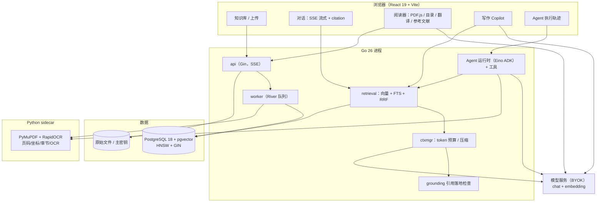

# 传智杯「AI 大模型创新应用挑战赛」参赛版说明

> 赛道：AI 大模型创新应用挑战赛（个人赛）
> 作品名：**ConGoRAG 科研助手 —— 可溯源、抗幻觉的论文阅读与写作工作台**
> 参赛编号：1885438 · 陈晓乐（西华大学 软件工程 2023 级）
> 仓库：<https://github.com/XiaoleC05/CongoRAG>（分支 `cup-2026`）
> 基线：本项目 v5.0.2（MIT，本人所有）→ 参赛版在其上补齐"科研学术层"

---

## 1. 一句话定位

把「读论文」拆成一条可验证的链路：**PDF 解析出页码/坐标/章节 → 混合检索召回证据 →
模型逐句带引用作答 → 引用落地检查 → 点引用直接跳到原文那一页那一块**；
在此之上提供 arXiv 检索、引用图谱、整页翻译与写作 Copilot。

解决的是科研读文献的三个真实痛点：

1. **"这句话出自哪一页？"** —— 大多数 RAG 只给文件名，不给页码与原文位置；
2. **"它是不是编的？"** —— 模型引用看似存在，实际对不上资料（幻觉引用）；
3. **"读完怎么用？"** —— 从检索到的证据直接生成相关工作/摘要草稿，并保留引用。

## 2. 赛题六模块对照

| # | 赛题模块 | 参赛版实现 | 关键代码 / 接口 |
|---|---|---|---|
| 1 | PDF 学术解析与页码溯源 | Python sidecar（PyMuPDF + RapidOCR）输出**块级** page / bbox / section_path / block_type；落库 migration 0015；SSE citation 带 page/bbox/sectionPath；前端阅读器按 bbox 高亮 | `sidecars/pdf-service/`、`internal/pdfparse/`、`migrations/0015_pdf_blocks`、`web/src/pages/ReaderPage.tsx` |
| 2 | 抗幻觉 RAG（混合检索 + 近重复抑制） | 中文 bigram + 英文小写切词 → Postgres FTS；pgvector 向量检索；**RRF 融合**（k=60）；`grounding` 事件做句子级引用落地检查；无证据时**固定拒答**（不经过模型） | `internal/tokenize/`、`internal/retrieval/`、`migrations/0016_hybrid_search`、`internal/grounding/`、`internal/conversation/usecase.go` |
| 3 | 版式阅读与翻译 | PDF.js 渲染 + 章节目录侧栏（heading → outline 接口）+ 当前页文本一键翻译（保留公式/术语/引用编号） | `web/src/pages/ReaderPage.tsx`、`GET /documents/{id}/outline`、`POST /api/v1/translate` |
| 4 | arXiv 文献检索 | 自研 Atom 客户端 + Agent 工具 `arxiv_search`（模型自主决定检索词，返回标题/作者/摘要/链接） | `internal/arxiv/`、`internal/agent/tool_arxiv_search.go` |
| 5 | 引用图谱 | 参考文献抽取（reference 分块，md/txt 按行兜底）→ 与同库文档标题归一化匹配 → 阅读器"参考文献"面板标出库内命中 | `GET /documents/{id}/references`、`internal/knowledge/usecase.go` |
| 6 | 写作 Copilot | 基于知识库检索结果生成「相关工作 / 摘要 / 提纲」Markdown 草稿，逐句 [n] + 引用列表（可点页码回原文） | `POST /knowledge-bases/{id}/writing`、`web/src/components/knowledge/KnowledgeWritingPanel.tsx` |
| 6+ | 多篇对比（评分项 A6） | 横向比较不同论文在同一问题上的观点/方法：Markdown 对照表 + 综合结论 + 逐条证据页码 | `POST /knowledge-bases/{id}/compare`、`web/src/components/knowledge/KnowledgeComparePanel.tsx` |

## 3. 参赛增量（相对 v5.0.2 基线）

v5.0.2 已具备：知识库/文档流水线、pgvector 检索、SSE 流式问答、Agent 工具注册与
执行轨迹、BYOK 加密、幂等重放、完整前端。参赛版新增的是**科研学术层**：

- 新增 Python 解析 sidecar 与 Go 侧 `pdfparse` 客户端（页码/坐标/章节/OCR/表格）；
- 新增 migration 0015（文档页数、解析器版本；分块页码/bbox/章节/块类型/索引）；
- 新增 migration 0016（`search_text` + 生成列 `search_tsv` + GIN 索引）；
- 新增混合检索与 RRF 融合、检索调试三路分数；
- 新增 grounding 引用落地检查与无证据拒答；
- 新增阅读器（PDF.js）、章节目录、整页翻译；
- 新增 arXiv 检索工具、引用图谱接口与面板、写作 Copilot 接口与面板；
- 新增参赛版部署 compose（含 sidecar）与本文档。

> 按大赛要求，作品基于**本人 MIT 开源项目**优化，增量与基线边界在本文档与
> 技术文档中明确声明；Git 历史（`cup-2026` 分支）可逐条核对。

## 4. 系统架构



**数据流**：上传（api 落盘 + 入队）→ worker 解析（sidecar HTTP 契约）→ 切分/向量化 →
入库（分块 + 页码/坐标/章节 + search_text）；提问 → 向量 + FTS 双路召回 → RRF →
ctxmgr 组装（预算裁剪）→ 模型流式生成 → citation/grounding 随流下发 → 落库。

## 5. 快速开始（比赛评审本地运行）

### 5.1 依赖

- Docker（含 compose v2）
- 或者：Go 1.26、Node 22 + pnpm 11、Python 3.11+（PDF sidecar）

### 5.2 一键部署（推荐）

```bash
# 仓库根目录
docker build --target api     -t congorag-api:cup .
docker build --target worker  -t congorag-worker:cup .
docker build --target migrate -t congorag-migrate:cup .

cd deployments/competition
cp .env.example .env
docker compose up -d --build
# 打开 http://127.0.0.1:3210，按引导配置模型（BYOK）
```

### 5.3 开发模式

```bash
# 1) 数据库
make up                       # 只起 postgres（pgvector 0.8.6 + PG 18）
make migrate-up               # 数据库迁移（含 river）

# 2) PDF 解析 sidecar
cd sidecars/pdf-service
python -m venv .venv && .venv/Scripts/pip install -r requirements.txt -r requirements-ocr.txt
python -m uvicorn server:app --host 127.0.0.1 --port 8000

# 3) api / worker（两个终端）
CONGORAG_PDF_SERVICE_URL=http://127.0.0.1:8000 make dev
CONGORAG_PDF_SERVICE_URL=http://127.0.0.1:8000 make dev-worker

# 4) 前端
make dev-web                  # http://127.0.0.1:5173，代理到 3210
```

### 5.4 关键环境变量

| 变量 | 说明 | 默认 |
|---|---|---|
| `CONGORAG_DB_URL` | Postgres 连接串 | 见 `.env.example` |
| `CONGORAG_LISTEN_ADDR` | api 监听地址 | `127.0.0.1:3210` |
| `CONGORAG_PDF_SERVICE_URL` | sidecar 地址；不设则 PDF 通道关闭（md/txt 不受影响） | 空 |
| `CONGORAG_PDF_TIMEOUT` | 单次解析超时（541 页实测约 2 分钟） | `10m` |
| `CONGORAG_MAX_UPLOAD_BYTES` | 上传上限 | 32 MiB |

> 模型 API Key 不落配置文件：在界面里配置，用 AES-GCM 加密存库，主密钥在数据卷。

## 6. 效果数据（本机实测，2026-10-29）

| 项目 | 数据 |
|---|---|
| Attention Is All You Need（15 页） | 解析 3.1s / 434 分块，逐块带页码；目录 26 条 |
| 扫描版论文（自造 v1_img） | OCR 89.9s / 513 分块，全部带页码 |
| 《Understanding Deep Learning》541 页 / 21MB | 冷解析约 122s，端到端 ready 9486 分块；目录/翻译/参考文献可用 |
| 引用溯源 | SSE citation `page=7` + bbox + sectionPath；阅读器第 7 页琥珀色高亮命中原文 |
| 混合检索 | 中文查询"过拟合"命中词法一路；"convolutional layer" 双路命中 UDL 第 177/180/195 页 |
| 抗幻觉 | DeepSeek-V3 回答 2/2 句带 `[4][5]`，`grounding.valid=true`；无证据时固定拒答 |
| 写作 Copilot | 759 字「相关工作」草稿，逐句 [n]，4 条引用含页码 |
| arXiv | Agent 自主检索并返回 DiNAT 等真实论文（SSE 有 tool_call/tool_result） |
| 检索评测（7 条查询） | **hit@1 71.4% / hit@3 100% / MRR 0.833** |
| 引用页码命中（3 条问答） | **3/3**；grounding 通过 2/3（未通过的那条如实显示"部分未溯源"） |
| 近重复抑制 A/B | top-3 近重复对 1→0，hit@1 不降（评测报告 §6） |

> 评测方法与逐条结果见提交材料里的《评测报告》；复现脚本见
> [eval/retrieval-eval.mjs](eval/retrieval-eval.mjs)（复制 config.example.json 填自己的库 id）。

## 7. 评分对照（自评）

| 评分项 | 权重 | 本作品对应 |
|---|---:|---|
| Agent / LLM 应用深度 | 35% | Agent 工具编排（知识库/会话/计算器/arXiv）、流式编排、混合检索、grounding 闸门、写作与翻译两类生成任务 |
| 场景创新 | 25% | "引用落地检查 + 页码/坐标跳原文"闭环；文献阅读→检索→写作工作台；引用图谱库内匹配 |
| 工程完整度 | 10% | Go + React + Python sidecar 三进程；openapi 契约驱动；migration；Docker Compose；测试与 CI |
| 业务闭环 | 10% | 上传→解析→检索→问答→溯源→写作→导出草稿；失败路径有明确文案与降级 |
| UI/UX | 10% | 深色科研工作台；引用角标/阅读器/目录/翻译/参考文献/写作面板；键盘可达 |
| 学术价值 | 10% | 可溯源问答、抗幻觉评测口径（grounding 指标）、引用图谱与写作辅助 |

## 8. AI 辅助编程声明

本作品在开发过程中使用了 AI 编程助手（DeepSeek Harness / Claude Code 类工具）辅助
编码、测试与文档起草；**架构决策、技术选型、验收标准与最终代码审查由作者完成**。
Prompt 设计、修改原因与效果记录见 [prompt-audit.md](prompt-audit.md)；
每次提交的意图见 Git 历史与 `docs/competition/` 下的说明。

## 9. 已知限制

1. 参考文献分块可能从半条文献开始（sidecar 按版面切块），首条编号可能缺失；
2. 引用图谱靠标题文本包含匹配，同名不同年/翻译标题会误配；
3. 无证据拒答目前只以"检索结果为空"为门槛，尚未接入 rerank 分数阈值；
4. 大文档（>500 页）首次解析耗时分钟级，已通过缓存与 10 分钟超时兜底；
5. sidecar 的 OCR 仅覆盖扫描件场景，复杂公式仍以文本层为准。

## 10. 提交材料

四件套（技术文档 PDF、演示视频、自检清单、评测报告）随仓库分发在
[submission/](submission/README.md)，评委可直接下载；代码即本仓库 `cup-2026` 分支。

## 11. 目录

- [submission/](submission/README.md) —— 四件套提交材料（视频/PDF/清单/评测）
- [prompt-audit.md](prompt-audit.md) —— Prompt 审计记录（版本/原因/效果/代码位置）
- [../../docs/sse-protocol.md](../sse-protocol.md) —— SSE 协议（含 citation/grounding 帧）
- [../../README.md](../../README.md) —— 基线项目完整文档
