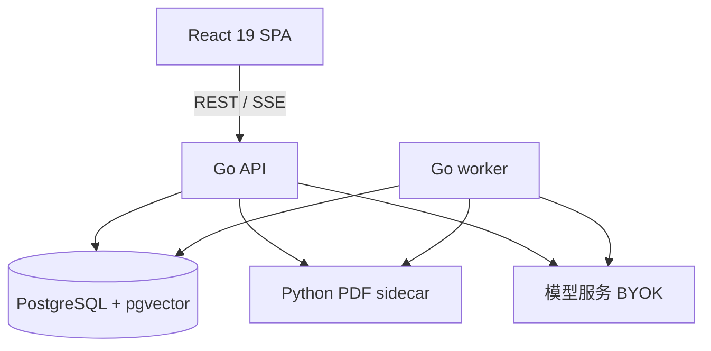

# CongoRAG 科研助手：模块与实现

当前版本 v6.7.1。本页按功能模块说明实现位置与关键接口；安装、配置与运行方式见
[README](../README.md)，提交材料见 [docs/submission](submission/README.md)。

## 1. 文献解析与去重

- **块级解析**：Python sidecar（PyMuPDF + RapidOCR）读取 PDF，输出标题/正文/表格/公式/
  参考文献等块，带页码、归一化坐标、章节路径。代码：`sidecars/pdf-service/`、
  `internal/pdfparse/`、migration 0015。
- **长文档与扫描件**：541 页教材与扫描版论文进入同一流水线；解析器版本与页数落库，
  失败可重试。
- **上传去重**：按正文 SimHash（词频保留）判重，v1/v7 距离 6 时告警，支持保留两者、
  覆盖旧版、对比版本差异。代码：`internal/knowledge/fingerprint.go`、migration 0018。
- **首页元信息块**：解析后额外生成一个 page=1 的作者/机构块，改善"作者是谁"类问题
  的召回与可溯源回答。

## 2. 抗幻觉问答与多文推理

- **混合检索**：中文 bigram + 英文词的 FTS、pgvector 向量检索、RRF(k=60) 融合；
  检索调试返回向量分/词法分/融合分。代码：`internal/tokenize/`、`internal/retrieval/`。
- **引用与 grounding**：SSE 先下发 citation，再逐 token 输出回答；结束时做句子级引用
  落地检查，没有证据时固定拒答，不调用模型。
- **多篇对比**：`POST /knowledge-bases/{id}/compare`，按维度生成带 [n] 的对照表。
- **页码锚点**：citation 带 page / bbox / sectionPath，阅读器按坐标高亮。

## 3. 阅读与翻译

- PDF.js 直连渲染；章节目录来自 heading 分块；正文引用与 References 双向跳转。
- 双语对照：原文/译文双栏、滚动同步、划词翻译、悬停翻译；目标语言支持中文/English。
- 整页翻译：保留公式、术语与引用编号。
- 响应式与可访问性（v6.5.0）：窄屏目录/双语对照改为抽屉；canvas 带 role=img 与页码标签；
  加载态 role=status；分区标题用 h2；引用 bbox 只在对应页渲染。
- 命令面板（v6.5.0）：`web/src/components/CommandPalette.tsx`，⌘K/Ctrl+K，
  跨知识库/会话/Agent/页面/主题动作跳转，懒加载 + 空闲预取。
- 代码：`web/src/pages/ReaderPage.tsx`、`web/src/lib/reader.ts`、`internal/llm/usecase.go`、`POST /api/v1/translate`。

## 4. arXiv 检索、追踪与推荐

- Agent 工具 `arxiv_search`：模型自主决定检索式，返回标题/作者/摘要/链接。
- 推荐：用库内标题关键词检索最新论文，按相关性、近 90 天、GitHub 代码、会议/期刊
  线索排序；赞/踩持久化，down 的论文过滤；面板每 5 分钟自动追踪。
- 下钻入库：`POST /arxiv-ingest`，服务端下载 arXiv PDF 后复用上传/解析流水线。
- 代码：`internal/arxiv/`、`internal/recommend/`、migration 0019。

## 5. 引用图谱与综述

- 参考文献标题与库内文档标题归一化匹配，聚合成有向图；PageRank 取前 20% 作为基石论文。
- 前端 SVG 环形图，节点大小按 PageRank，点击节点跳阅读器。
- `POST /citation-survey`：把图上论文片段与引用关系交给模型，生成领域综述和
  Future Work；结合 arXiv 年份线索只保留仍开放的方向。
- 代码：`internal/knowledge/graph.go`、`internal/knowledge/usecase.go`。

## 6. 写作与可视化

- 写作 Copilot：相关工作/摘要/提纲/完整论文框架四种体例；每个事实句带 [n]，
  引用列表可点页码回原文；完整框架同时返回 Graphviz DOT。
- CSV 可视化：解析表格，自动选列与图表类型，生成 Mermaid/TikZ/Matplotlib 代码
  与学术 Figure Caption；前端 SVG 预览。
- 代码：`POST /knowledge-bases/{id}/writing`、`POST /api/v1/visualize`、
  `web/src/components/knowledge/`。

## 7. 架构与数据流

上传在 api 落盘并入队；worker 解析、切分、向量化；问答由 api 混合检索、组装上下文、
流式生成，citation/grounding 随流下发并落库。前后端通过 OpenAPI 契约生成类型，
前端产物 `go:embed` 进单个 Go 二进制。

## 8. Agent 边界与验证

Agent 只承担"需要多步工具调用"的任务：检索 arXiv、查知识库、算数。它不接管整个系统，
也不为每个子任务再拆一个 Agent——单 Agent + 工具循环足够覆盖当前场景，少一层路由就少
一层不可审计的状态。

- 工具全部只读或低风险；写操作（上传、删除、入库）必须由用户显式触发，Agent 不能代点。
- 每次 tool_call / tool_result 落库，运行可取消、可从断点恢复。
- 回答的可信度由检索证据、逐句引用和 grounding 校验决定，不由 Agent 的"自信"决定；
  没有证据时固定拒答。
- 如果将来接入写操作，先加权限边界与人工确认，再考虑多 Agent 路由，不为架构图好看
  提前引入复杂度。

## 9. Prompt 治理、评测与复现

- **安全基线（v6.4.0）**：安全响应头与 CSP、两档令牌桶限流、上传内容嗅探与文件名净化、SSE 空闲心跳；见 [SECURITY.md](../SECURITY.md)。
- **Prompt 注册表**：`internal/prompt`，版本 + 完整文本 + SHA-256 + 变更原因 +
  采样参数 + 代码位置；`GET /api/v1/prompts` 与界面「Prompt 审计」页只读展示，
  api 启动时校验结构。设计见 [ADR-010](adr/010-prompt-registry.md)。

- 检索评测脚本与结果：[docs/evaluation/](evaluation/)
- Prompt 审计：[docs/prompt-audit.md](prompt-audit.md)
- 演示数据种子：`node scripts/seed-demo.mjs --api http://127.0.0.1:3210 --dir ./pdf`
- 一键部署：`deployments/production/`（api / worker / pdf sidecar / PostgreSQL）
- 测试：Go `go test ./...`；前端 `pnpm --filter web test`；契约 `make check`
